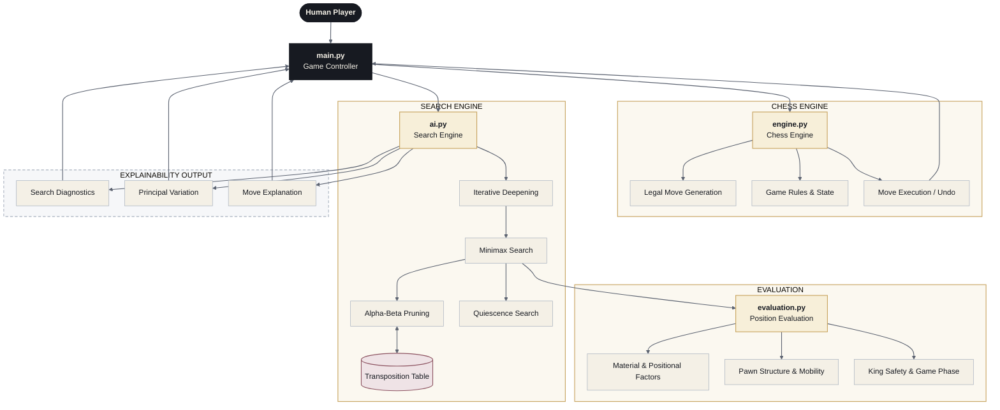
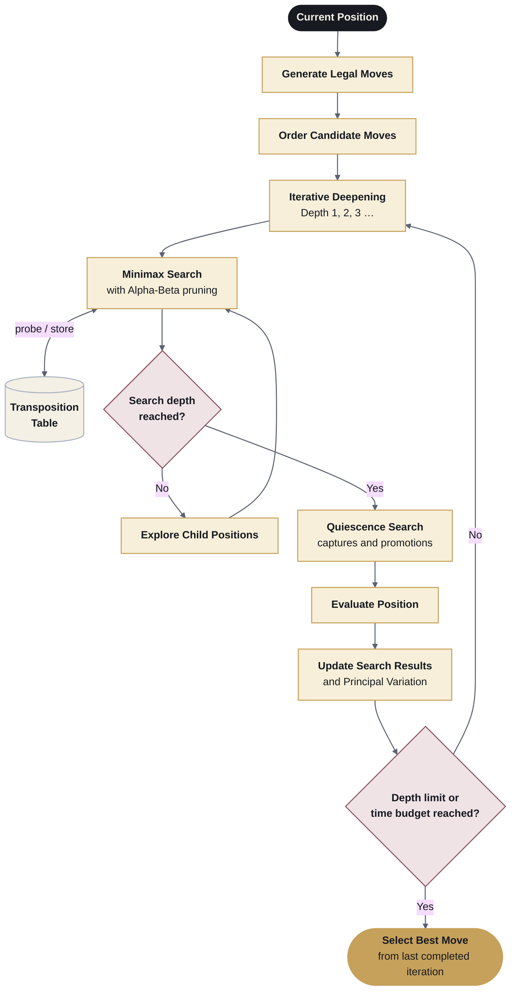
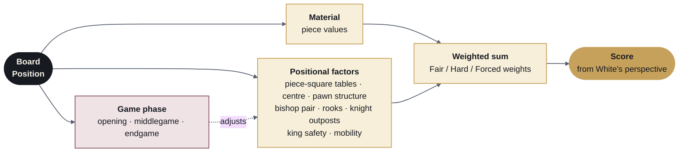
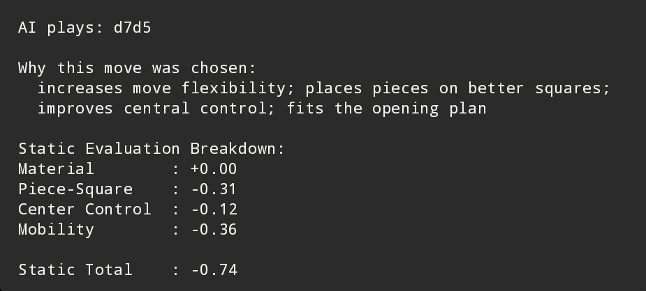
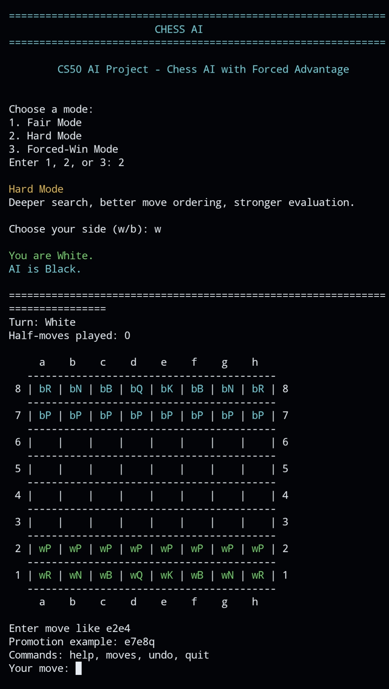

<div align="center">

# EXPLAINABLE CHESS AI

### Classical Artificial Intelligence · Adversarial Search · Heuristic Evaluation

**A chess engine built on structured reasoning, strategic search and transparent decision-making.**

[](https://github.com/Nomusa990822/Chess-AI)
[](https://www.python.org/)
[](https://github.com/Nomusa990822/Chess-AI)
[](https://github.com/Nomusa990822/Chess-AI)

[](https://github.com/Nomusa990822/Chess-AI)
[](https://github.com/Nomusa990822/Chess-AI/commits/main)
[](https://github.com/Nomusa990822/Chess-AI)

<br/>

[**Overview**](#01--overview) · [**Capabilities**](#02--core-capabilities) · [**Architecture**](#04--system-architecture) · [**Search**](#05--search--decision-making) · [**Evaluation**](#06--evaluation-methodology) · [**Explainability**](#07--explainability) · [**Run It**](#10--installation--execution)

</div>

---

## Contents

| | | | |
|---|---|---|---|
| [01 Overview](#01--overview) | [05 Search & Decision-Making](#05--search--decision-making) | [09 Project Structure](#09--project-structure) | [13 Limitations & Future Development](#13--current-limitations--future-development) |
| [02 Core Capabilities](#02--core-capabilities) | [06 Evaluation Methodology](#06--evaluation-methodology) | [10 Installation & Execution](#10--installation--execution) | [14 Documentation](#14--documentation) |
| [03 Game Modes](#03--game-modes) | [07 Explainability](#07--explainability) | [11 Testing](#11--testing) | [15 Author](#15--author) |
| [04 System Architecture](#04--system-architecture) | [08 Application Preview](#08--application-preview) | [12 Design Principles](#12--design-principles) | |

---

## 01 / Overview

**Explainable Chess AI** is a terminal-based chess engine that demonstrates how classical artificial intelligence techniques can be combined to produce strategic, interpretable decision-making.

Rather than relying on a trained neural network, the system uses adversarial search and handcrafted evaluation heuristics to examine possible game states, assess positional advantages and select moves.

The project brings together three interconnected components:

- **Chess Engine**: a deterministic implementation of chess rules and game-state management.
- **Search Engine**: an adversarial decision-making system built around Minimax and Alpha-Beta pruning.
- **Evaluation & Explainability**: a heuristic framework that scores positions and exposes information about the AI's decisions.

The objective is not simply to produce a playable chess opponent. It is to demonstrate how an AI system can reason about a structured problem, optimise its search and communicate meaningful information about its decisions.

### At a Glance

| | |
|---|---|
| **Language** | Python 3, standard library only |
| **Search** | Minimax with Alpha-Beta pruning, iterative deepening, transposition table, quiescence search |
| **Evaluation** | Handcrafted heuristics: material, piece-square tables, pawn structure, king safety, mobility, game phase |
| **Explainability** | Search diagnostics, evaluation breakdowns, top candidate moves and principal variation |
| **Modes** | Fair · Hard · Forced-Win |
| **Interface** | Terminal |
| **Testing** | Automated `pytest` suite covering the engine, evaluation and preset positions |

### Quick Start

```bash
git clone https://github.com/Nomusa990822/Chess-AI.git
cd Chess-AI
python main.py
```

---

## 02 / Core Capabilities

### Chess Engine

A dedicated game-state implementation responsible for the rules and mechanics of chess.

- Legal move generation
- Check and checkmate detection
- Stalemate detection
- Castling
- En passant
- Pawn promotion
- Move execution and undo
- Draw-by-repetition tracking
- Position-state tracking

### Adversarial Search

The AI explores possible future positions and selects moves using a combination of search algorithms and optimisation techniques.

| Technique | Purpose |
|---|---|
| Minimax | Models optimal decision-making in a two-player, zero-sum game |
| Alpha-Beta pruning | Eliminates branches that cannot influence the final decision |
| Iterative deepening | Searches progressively deeper while respecting a time budget |
| Move ordering | Prioritises promising moves to improve pruning efficiency |
| Transposition table | Reuses information from previously searched positions |
| Quiescence search | Extends tactical positions beyond the normal search-depth boundary |
| Principal variation | Tracks the best predicted sequence of moves |

### Heuristic Position Evaluation

The evaluation system combines multiple positional factors into a numerical score.

- Material balance
- Piece-square tables
- Centre control
- Pawn structure
- Bishop pair advantage
- Open and semi-open rook files
- Rook activity on the seventh rank
- Knight outposts
- King pawn-shield protection
- Mobility
- Game-phase awareness
- Endgame king activity
- Edge pressure in winning endgames

### Explainable AI

The system exposes information about its search and evaluation process.

- Selected-move explanation
- Static evaluation breakdown
- Before-and-after evaluation comparison
- Top candidate moves
- Principal variation
- Search depth reached
- Nodes explored
- Quiescence nodes
- Alpha-Beta pruning count
- Transposition-table hits

> [!NOTE]
> These outputs are heuristic explanations and search diagnostics. They provide an interpretable view of the engine's decision process, not a complete causal proof of why a move is optimal.

---

## 03 / Game Modes

The application provides three configurable difficulty modes.

| Mode | Search depth limit | Time budget |
|---|---:|---:|
| Fair | 2 | 1.0 seconds |
| Hard | 4 | 2.0 seconds |
| Forced-Win | 5 | 2.5 seconds |

The actual depth reached can be lower than the configured limit because the search observes its time budget.

**Forced-Win mode** loads a predefined queen-versus-king endgame position. The current preset gives Black the queen advantage and Black the first move. The player can choose either colour, so the AI is not guaranteed to be the advantaged side in every configuration.

---

## 04 / System Architecture

The project follows a modular architecture that separates game rules, search, evaluation and presentation.



### Architectural Responsibilities

| Module | Responsibility |
|---|---|
| `main.py` | Game flow, player interaction and AI orchestration |
| `engine.py` | Chess rules, legal moves and game-state management |
| `ai.py` | Search algorithms, move selection and search reporting |
| `evaluation.py` | Position scoring and evaluation explanations |
| `forced_positions.py` | Preset endgame scenarios |
| `utils.py` | Terminal presentation and user-input utilities |
| `tests/` | Automated correctness and behaviour tests |
| `docs/` | Architecture and search documentation |

---

## 05 / Search & Decision-Making

The search engine uses a depth-limited Minimax algorithm to evaluate possible sequences of moves.

Chess is treated as a two-player, zero-sum game:

- White attempts to **maximise** the evaluation.
- Black attempts to **minimise** the evaluation.
- Scores are consistently calculated from **White's perspective**.

### Search Pipeline



### Minimax

Minimax evaluates possible moves under the assumption that both players make rational decisions. At each level, the engine alternates between maximising and minimising the evaluation score.

### Alpha-Beta Pruning

Alpha-Beta pruning improves search efficiency by eliminating branches that cannot affect the final result. It maintains two bounds:

- **Alpha:** the best value currently available to the maximising player.
- **Beta:** the best value currently available to the minimising player.

When alpha becomes greater than or equal to beta, the remaining branch can be pruned.

### Iterative Deepening

Rather than immediately attempting a deep search, the engine searches progressively:

1. Depth 1
2. Depth 2
3. Depth 3
4. Subsequent depths until the configured limit or time budget is reached.

This allows the engine to retain a usable result from the last completed search iteration.

### Transposition Table

Different move sequences can lead to the same board position. The transposition table stores previously searched position information so that useful results can be reused instead of repeatedly calculating equivalent positions.

### Quiescence Search

A fixed search depth can terminate in the middle of a tactical sequence, creating the horizon effect. Quiescence search extends the evaluation of unstable positions through captures and pawn promotions until a quieter position is reached.

### Principal Variation

The principal variation (PV) represents the engine's best predicted continuation from the current position. It provides a readable line of moves associated with the search result.

---

## 06 / Evaluation Methodology

The evaluation system translates a board position into a numerical score.



All evaluation scores are expressed from White's perspective:

| Score | Interpretation |
|---|---|
| Positive | Advantage for White |
| Negative | Advantage for Black |
| Near zero | Approximately balanced position |

### Material

| Piece | Value |
|---|---:|
| Pawn | 1.00 |
| Knight | 3.00 |
| Bishop | 3.25 |
| Rook | 5.00 |
| Queen | 9.00 |
| King | 0.00 |

The king is not assigned a conventional material value because its importance is represented through game rules and positional evaluation.

### Positional Evaluation

Beyond material, the engine considers:

| Factor | What it evaluates |
|---|---|
| **Piece-square tables** | Rewards useful piece placement |
| **Centre control** | Occupation of central squares |
| **Pawn structure** | Doubled, isolated, passed and connected pawns |
| **Bishop pair** | Possession of both bishops |
| **Rook activity** | Open files, semi-open files and seventh-rank placement |
| **Knight outposts** | Supported advanced knight positions |
| **King safety** | Pawn-shield protection |
| **Mobility** | Number of legal moves available to each side |
| **Game phase** | Adjusts positional considerations for the opening, middlegame or endgame |
| **King activity** | Appropriate king activity in endgames |
| **Edge pressure** | Restricting the opposing king when a material advantage exists |

### Difficulty-Dependent Weights

The evaluation system supports different weighting configurations for Fair, Hard and Forced modes. This allows the engine to adjust its positional priorities without changing the underlying chess rules.

---

## 07 / Explainability

A central design objective is making the engine's decision-making observable.

After an AI move, the application presents information about the search and the resulting position.

### Example Output

```text
AI Search Report

Depth reached:        [depth]
Nodes explored:       [nodes]
Quiescence nodes:     [q_nodes]
Prunes:               [prunes]
TT hits:              [tt_hits]
Search evaluation:    [score]
Game phase:           [phase]

Top candidate moves:
1. [candidate] -> [score]
2. [candidate] -> [score]
3. [candidate] -> [score]

Best line (Principal Variation):
[move] -> [move] -> [move]

Why this move was chosen:
[Heuristic move explanation]
```

The system also provides:

- Evaluation component breakdowns
- Evaluation changes before and after an AI move
- A comparison of candidate moves
- A predicted continuation of play

This makes it possible to inspect not only which move the engine selected, but also the search and evaluation information associated with that decision.

### Explainability Preview

<p align="center">
  
</p>

---

## 08 / Application Preview

<p align="center">
  
</p>

---

## 09 / Project Structure

```text
Chess-AI/
│
├── main.py
├── engine.py
├── ai.py
├── evaluation.py
├── forced_positions.py
├── utils.py
│
├── docs/
│   ├── architecture.md
│   └── search_notes.md
│
├── tests/
│   ├── test_engine.py
│   ├── test_evaluation.py
│   └── test_forced_positions.py
│
├── assets/
│   ├── game_preview.jpg
│   └── explainability_example.jpg
│
├── .gitignore
└── README.md
```

---

## 10 / Installation & Execution

### Prerequisites

- Python 3
- Git
- A terminal or command-line environment

The application uses Python's standard library; no third-party runtime package is required by the current source files.

### Clone the Repository

```bash
git clone https://github.com/Nomusa990822/Chess-AI.git
cd Chess-AI
```

### Run the Application

```bash
python main.py
```

On systems where Python is invoked using `python3`:

```bash
python3 main.py
```

### Run the Tests

Install `pytest` if it is not already available:

```bash
python -m pip install pytest
```

Run the complete test suite:

```bash
python -m pytest -v
```

---

## 11 / Testing

The repository contains automated tests covering three major areas.

| Test module | Testing focus |
|---|---|
| `test_engine.py` | Legal moves, move execution, undo, special moves and repetition |
| `test_evaluation.py` | Material, positional scoring, game phases and evaluation behaviour |
| `test_forced_positions.py` | Preset positions, piece placement, castling restrictions and move generation |

The tests help validate individual components and important game behaviours.

---

## 12 / Design Principles

| Principle | In practice |
|---|---|
| **Deterministic rules, heuristic intelligence** | The chess engine enforces explicit rules, while the AI uses search and evaluation to make decisions |
| **Separation of concerns** | Game-state management, search, evaluation and presentation live in separate modules |
| **Interpretability** | The engine exposes evaluation information and search diagnostics rather than presenting its move without context |
| **Computational efficiency** | Search optimisations reduce unnecessary exploration and help the engine work within a time budget |
| **Testability** | Individual components are tested independently, making correctness easier to inspect and maintain |

---

## 13 / Current Limitations & Future Development

### Current Limitations

- Search is bounded by configured depth and time budgets.
- Evaluation relies on handcrafted heuristics rather than a learned model.
- Quiescence search currently focuses on captures and promotions.
- The engine does not learn from completed games.
- No graphical user interface is currently included.
- The Forced-Win preset does not automatically adapt to the selected AI colour.

### Potential Improvements

- [ ] Zobrist hashing for efficient position identification
- [ ] Killer-move and history heuristics
- [ ] Aspiration windows
- [ ] Opening-book integration
- [ ] Endgame tablebase support
- [ ] PGN import and export
- [ ] Graphical interface
- [ ] AI-versus-AI gameplay
- [ ] Optional machine-learning evaluation

---

## 14 / Documentation

Additional technical documentation is available in the repository:

- [System Architecture](docs/architecture.md)
- [Search & Decision-Making Notes](docs/search_notes.md)

---

## 15 / Author

**Nomusa Shongwe**

[GitHub](https://github.com/Nomusa990822) · [Chess-AI Repository](https://github.com/Nomusa990822/Chess-AI)

---

<div align="center">

### STRUCTURED REASONING. STRATEGIC SEARCH. EXPLAINABLE DECISIONS.

*Demonstrating how classical artificial intelligence can produce intelligent behaviour through search, optimisation and carefully designed evaluation.*

**Built with Python.**

<sub>[Back to top](#explainable-chess-ai)</sub>

</div>
