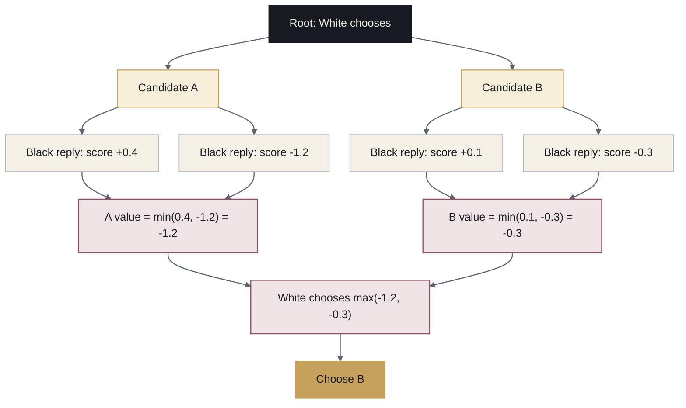
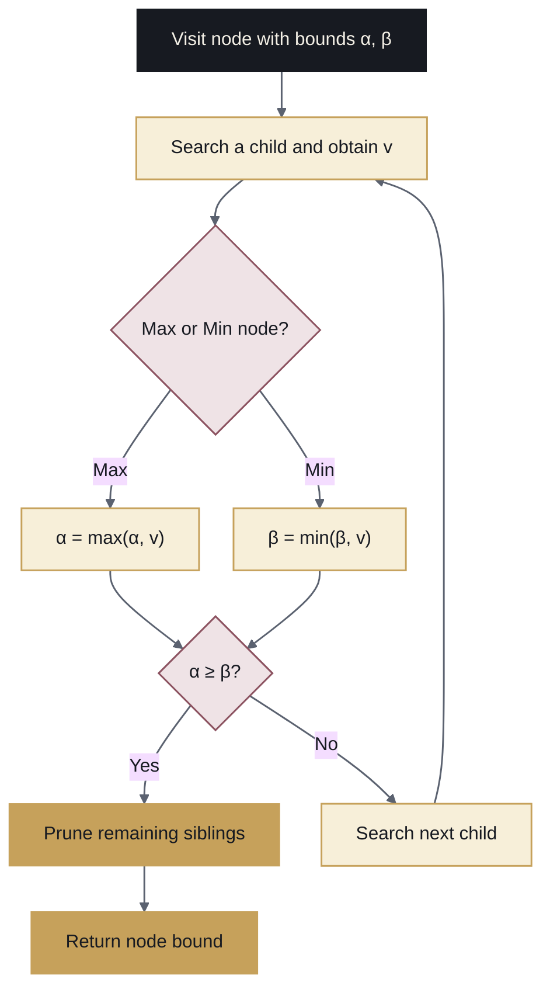
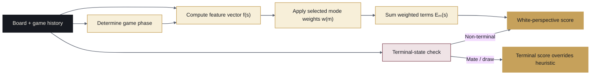

# Mathematical Foundations of the Chess AI

This document derives the main equations used by the classical search engine and
connects each mathematical idea to its implementation. The engine is a
**deterministic, two-player, zero-sum, perfect-information game searcher** with
a handcrafted evaluation function. It is not a neural network and it does not
learn its evaluation weights from data.

## Contents

1. [Formalising chess as a search problem](#1-formalising-chess-as-a-search-problem)
2. [Minimax: optimal play under an adversarial assumption](#2-minimax-optimal-play-under-an-adversarial-assumption)
3. [Alpha-Beta pruning: bounding irrelevant subtrees](#3-alpha-beta-pruning-bounding-irrelevant-subtrees)
4. [Iterative deepening and time-bounded correctness](#4-iterative-deepening-and-time-bounded-correctness)
5. [Static evaluation: turning a board into a number](#5-static-evaluation-turning-a-board-into-a-number)
6. [Quiescence search and the horizon effect](#6-quiescence-search-and-the-horizon-effect)
7. [Transposition tables: reusing searched states](#7-transposition-tables-reusing-searched-states)
8. [Move ordering: making pruning effective](#8-move-ordering-making-pruning-effective)
9. [Principal Variation Search (experimental)](#9-principal-variation-search-experimental)
10. [Aspiration windows (experimental)](#10-aspiration-windows-experimental)
11. [What the mathematics does, and does not, establish](#11-what-the-mathematics-does-and-does-not-establish)

---

## 1. Formalising chess as a search problem

Represent a game state by $s\in\mathcal{S}$, where a state contains the board,
side to move, castling and en-passant rights, move counters, and repetition
history. Let $A(s)$ be the legal actions in state $s$, and let
$T(s,a)$ be the state reached after legal action $a$.

The engine uses a **White-perspective** score:

- positive values favour White;
- negative values favour Black;
- zero represents a draw or an approximately balanced heuristic position.

This fixed score orientation is important: the search alternates between
maximising and minimising, but the evaluation function never changes sign just
because the side to move changes.

## 2. Minimax: optimal play under an adversarial assumption

At a terminal state, the value is the game result $R(s)$. At a depth-limited
leaf, the value is the static heuristic evaluation $E(s)$. For non-terminal
states, the depth-limited minimax recurrence is:

$$
V(s,d)=
\begin{cases}
R(s), & s \text{ is terminal},\\
E(s), & d=0,\\
\max\limits_{a\in A(s)} V\bigl(T(s,a),\,d-1\bigr), & \text{White to move},\\
\min\limits_{a\in A(s)} V\bigl(T(s,a),\,d-1\bigr), & \text{Black to move}.
\end{cases}
$$

Here, $d$ is the remaining search depth, and the cases are read top to bottom:
a terminal state is scored first, then a depth-limited leaf, then the
recursive cases. The recurrence models an opponent who chooses the response
least favourable to the current player. This is the reason a locally
attractive move can be rejected: its value is determined by the opponent's
strongest reply, not by the immediate gain alone.

### A two-ply decision schematic

The example is illustrative rather than a recorded game position. White chooses
the larger of the two worst-case child values, so Candidate B is preferred.

## 3. Alpha-Beta pruning: bounding irrelevant subtrees

Minimax can examine approximately $O(b^d)$ nodes in a tree with average
branching factor $b$ and depth $d$. Alpha-Beta pruning returns the same
minimax value while avoiding branches already proven unable to change an
ancestor's choice.

- $\alpha$: the best (highest) value already guaranteed to the maximizing
  player along the current path.
- $\beta$: the best (lowest) value already guaranteed to the minimizing
  player along the current path.

The pruning condition is:

$$
\boxed{\alpha\geq\beta\quad\Longrightarrow\quad\text{cut off the remaining siblings}}
$$

At a maximizing node, update $\alpha\leftarrow\max(\alpha,v)$. At a
minimizing node, update $\beta\leftarrow\min(\beta,v)$. If the bounds
cross, the remaining children cannot improve the decision already available
above this node.

### Search-bound schematic

With ideal move ordering, Alpha-Beta's effective leaf count can approach
$O(b^{d/2})$; with poor ordering its worst-case complexity remains
$O(b^d)$. These are theoretical search-tree bounds, not a promise of a
specific runtime or node count for this engine.

## 4. Iterative deepening and time-bounded correctness

Instead of starting with a single deep search, the engine completes successive
depths:

$$
d=1,2,3,\ldots,D.
$$

Let $m_d$ and $v_d$ be the best move and score from a **completed**
iteration at depth $d$. The published result is the deepest completed
iteration before the deadline, not a partially explored iteration. This gives
the caller a legal fallback even when the time budget interrupts a later depth.

The search deadline uses a monotonic clock. A timeout propagates out of the
current iteration; the previous completed result is retained.

## 5. Static evaluation: turning a board into a number

The evaluation function is a weighted linear combination of handcrafted
features. For a non-terminal position:

$$
\boxed{E_m(s)=\sum_{i=1}^{n} w_{m,i}\,f_i(s)}
$$

where $f_i(s)$ is a feature score, $w_{m,i}$ is its mode-specific
weight, and $m\in\lbrace\text{fair},\text{hard},\text{forced}\rbrace$.
Every feature is expressed from White's perspective. This is a transparent
weighted heuristic, not a probability of winning.

### 5.1 Material balance

Let $P(s)$ be the pieces on the board, $c(p)=+1$ for White and
$c(p)=-1$ for Black, and $v(p)$ the configured piece value:

$$
M(s)=\sum_{p\in P(s)} c(p)\,v(p).
$$

The implementation uses pawn $1$, knight $3$, bishop $3.25$, rook
$5$, queen $9$, and king $0$. The king's value is represented by
terminal rules and positional terms rather than an exchange value.

### 5.2 Positional and structural terms

The implementation combines the following terms (their constants are
heuristic design choices, not universal chess-theory constants):

| Feature | Mathematical interpretation in this implementation |
|---|---|
| Piece-square tables | Sum the table entry for each piece's square, adding White and subtracting the vertically mirrored Black entry. |
| Centre control | Add/subtract 0.25 for occupancy of each of the four central squares and 0.10 for occupancy of the extended centre. |
| Pawn structure | Apply penalties for doubled pawns (0.35 per extra pawn) and isolated pawns (0.20 each); reward passed-pawn advancement and adjacent pawn support using the constants in `evaluation.py`. |
| Bishop pair | +0.35 for White's pair and -0.35 for Black's pair. |
| Rook files | +0.30 per rook on a fully open file, +0.15 on a file open for that side; apply the opposite sign for Black. |
| Rook on seventh rank | +0.20 per qualifying White rook and -0.20 per qualifying Black rook. |
| Knight outpost | +0.25 / -0.25 for a supported advanced knight that cannot be chased by an enemy pawn. |
| King pawn shield | +0.12 / -0.12 per shielding pawn in non-endgames; disabled in the endgame. |
| Mobility | $0.05\,(L_W-L_B)$, where $L_W$ and $L_B$ are the legal-move counts for each side. |
| King activity | In an endgame with a material advantage, use the Manhattan king distance $D_1$: $\pm 0.04\,(14-D_1)$. |
| Edge pressure | When ahead in material, reward pushing the opposing king towards the edge using $0.20\,\max\bigl(\lvert 3.5-r\rvert,\ \lvert 3.5-c\rvert\bigr)$, with sign determined by the advantaged side. |

For the king-distance term:

$$
D_1=\lvert r_W-r_B\rvert+\lvert c_W-c_B\rvert.
$$

The game phase is classified using total non-king material $Q$:

$$
\text{phase}(s)=
\begin{cases}
\text{opening}, & Q>40,\\
\text{middlegame}, & 18<Q\leq 40,\\
\text{endgame}, & Q\leq 18.
\end{cases}
$$

The phase selects the king piece-square table and gates endgame king activity
and non-endgame pawn-shield scoring.

### 5.3 Mode-dependent weights

The actual weights returned by `get_evaluation_weights` are:

| Feature | Fair | Hard | Forced |
|---|---:|---:|---:|
| Material | 1.0 | 1.0 | 1.0 |
| Piece-square | 0.6 | 0.7 | 0.7 |
| Centre control | 0.4 | 0.5 | 0.4 |
| Pawn structure | 0.5 | 0.7 | 0.8 |
| Bishop pair | 0.2 | 0.4 | 0.4 |
| Rook activity | 0.2 | 0.4 | 0.4 |
| Knight outpost | 0.2 | 0.4 | 0.4 |
| King shield | 0.2 | 0.5 | 0.4 |
| Mobility | 0.0 | 0.8 | 0.9 |
| King activity | 0.0 | 0.6 | 0.9 |
| Edge pressure | 0.0 | 0.0 | 1.2 |

Thus the total is explicitly:

$$
E_m(s)=w_{m,M}\,M(s)+w_{m,PS}\,PS(s)+w_{m,C}\,C(s)+\cdots+w_{m,EP}\,EP(s).
$$

The mode changes the relative importance of features; it does not change the
rules of chess or make the evaluation learned. Terminal checkmate is handled
separately using a large score ($\pm 9999$, adjusted by ply to prefer faster
mates and delay losses); draws return zero.

### Evaluation data flow

## 6. Quiescence search and the horizon effect

A depth-limited search can stop immediately after a capture or before a forced
recapture. The static evaluation at that boundary may therefore be misleading.
Quiescence search extends selected tactical continuations beyond the nominal
depth.

For a quiet position, the engine first considers the stand-pat evaluation
$E(s)$, then searches legal captures and promotions. In check, stand-pat is
not legal: the engine searches **all legal evasions**, including quiet king
moves and interpositions. The implementation has a hard quiescence-depth cap
of 8 as a computational safeguard.

Quiescence reduces some horizon errors; it does not prove that every long
tactical sequence is resolved.

## 7. Transposition tables: reusing searched states

A transposition occurs when different move orders reach an equivalent state.
A table entry stores:

$$
(\text{key},\ d,\ v,\ \text{bound flag},\ \text{best move},\ \text{PV}).
$$

The bound flag has three meanings:

- **EXACT:** the stored value is the minimax value for the searched depth.
- **LOWERBOUND:** the value is at least the stored score.
- **UPPERBOUND:** the value is at most the stored score.

A bound can tighten the current window:

$$
\alpha\leftarrow\max(\alpha,v_{LB}),\qquad
\beta\leftarrow\min(\beta,v_{UB}).
$$

The engine keys entries by board-position identity, halfmove clock, and a
sorted snapshot of the repetition-count map. This deliberately includes
draw-relevant history: identical piece placement alone is insufficient when
the 50/75-move counters or repetition context differ. Replacement prefers a
deeper entry, and at equal depth prefers an exact entry over a bound entry.

## 8. Move ordering: making pruning effective

Alpha-Beta's result is independent of move order, but the amount of pruning is
not. The engine prioritises a transposition-table move, tactical moves, killer
moves and then history-scored quiet moves.

When a quiet move causes a cutoff at depth $d$, the history score is updated
by:

$$
H(s,a)\leftarrow\min\bigl(H_{\max},\ H(s,a)+d^2\bigr),
$$

where $H_{\max}=1{,}000{,}000$. Up to two killer moves are retained per
search ply. These are ordering heuristics only: they do not change legal moves
or the static evaluation.

## 9. Principal Variation Search (experimental)

Principal Variation Search (PVS) assumes that the first ordered move is the
most promising. It searches that move with the current full window. Later
moves are initially tested with a narrow null window of width

$$
\varepsilon=10^{-6}.
$$

A later move that appears to improve the incumbent without already causing a
cutoff is re-searched with the full window. Correct move ordering is therefore
important. PVS is opt-in in this project; it is not the production default.

## 10. Aspiration windows (experimental)

After a completed iterative-deepening score $v_{d-1}$, aspiration search
starts the next depth with:

$$
\alpha=v_{d-1}-w,\qquad \beta=v_{d-1}+w.
$$

If the result is at or below the lower bound (fail-low), or at or above the
upper bound (fail-high), the window is widened and the iteration is retried.
After the configured retry limit, the search falls back to a full window.

The adaptive experiment estimates score stability using:

$$
\Delta_d=\lvert v_{d-1}-v_{d-2}\rvert,
$$

$$
w_d=\operatorname{clip}_{[0.1,\,4.0]}\Bigl(w_0\bigl(0.5+0.5\min(\Delta_d,\,4.0)\bigr)\Bigr).
$$

The first adaptive aspiration iteration uses the configured base width because
there is not yet a pair of completed scores. A smaller score change narrows
the next window; a larger change widens it, subject to the stated bounds.
Benchmarks found no consistent advantage over fixed width 0.5, so adaptive
aspiration remains experimental.

## 11. What the mathematics does, and does not, establish

Minimax is exact only with respect to the searched tree, terminal scoring,
depth limit and leaf evaluator. It does not establish the globally optimal
chess move when the full game tree has not been searched. The evaluation
weights are handcrafted. Benchmark move/score parity establishes agreement
between tested search modes on the tested positions; runtime samples do not
establish playing strength or Elo.

The implementation and benchmark evidence are maintained in
[`docs/phase1_search_reliability_audit.md`](phase1_search_reliability_audit.md).
