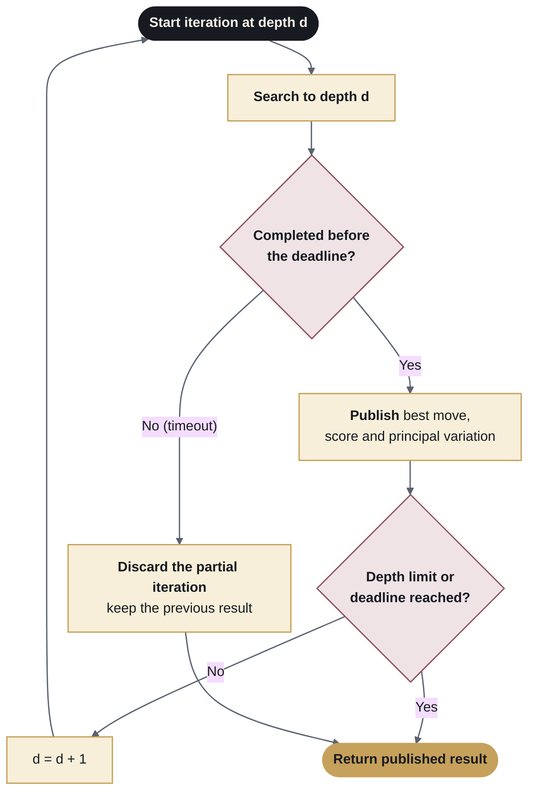

# Search & Decision-Making Notes

This note summarises the implemented search pipeline. The complete mathematical
derivations and feature equations are in
[Mathematical Foundations](mathematical_foundations.md).

## Contents

- [Search model](#search-model)
- [Techniques at a glance](#techniques-at-a-glance)
- [Alpha-Beta pruning](#alpha-beta-pruning)
- [Iterative deepening and deadlines](#iterative-deepening-and-deadlines)
- [Move ordering](#move-ordering)
- [Transposition table](#transposition-table)
- [Quiescence search](#quiescence-search)
- [Experimental search modes](#experimental-search-modes)
- [Complexity and limitations](#complexity-and-limitations)

---

## Search model

The engine treats chess as a deterministic, two-player, zero-sum,
perfect-information game. Evaluation scores are always from White's
perspective. White maximises the score and Black minimises it.

For state $s$, legal actions $A(s)$, transition $T(s,a)$, terminal result
$R(s)$, static evaluation $E(s)$, and remaining depth $d$:

$$
V(s,d)=
\begin{cases}
R(s), & s \text{ is terminal},\\
E(s), & d=0,\\
\max\limits_{a\in A(s)} V\bigl(T(s,a),\,d-1\bigr), & \text{White to move},\\
\min\limits_{a\in A(s)} V\bigl(T(s,a),\,d-1\bigr), & \text{Black to move}.
\end{cases}
$$

The cases are read top to bottom: a terminal state is scored first, then a
depth-limited leaf, then the recursive cases.

---

## Techniques at a glance

| Technique | Role | Status |
|---|---|---|
| Minimax | Models adversarial play in a zero-sum game | Implemented |
| Alpha-Beta pruning | Skips branches that cannot change the decision | Implemented; **full-window is the production default** |
| Iterative deepening | Searches depth 1, 2, 3 … within a time budget | Implemented |
| Move ordering | Improves pruning with TT, tactical, killer and history moves | Implemented |
| Transposition table | Reuses results for equivalent positions | Implemented |
| Quiescence search | Extends tactical leaves to reduce the horizon effect | Implemented |
| Principal Variation Search | Null-window probes for later moves | Experimental, opt-in |
| Aspiration windows | Searches around the previous completed score | Experimental, opt-in |
| Adaptive aspiration | Sizes the window from recent score change | Experimental, opt-in |

---

## Alpha-Beta pruning

Alpha-Beta maintains a lower bound $\alpha$ for the maximizing player and
an upper bound $\beta$ for the minimizing player. A branch is cut off when

$$
\boxed{\alpha\geq\beta}
$$

Pruning preserves the minimax result while reducing the number of nodes that
need to be visited. Its effectiveness depends strongly on move ordering.

---

## Iterative deepening and deadlines

The search completes depth 1, then 2, then 3, up to the configured limit or
deadline. Only a fully completed iteration replaces the current best move,
score and principal variation. A timeout never publishes a partial iteration.

---

## Move ordering

The ordering pipeline prioritises a transposition-table move, tactical moves,
killer moves and history-scored quiet moves. A quiet move that causes a cutoff
updates its history score by $d^2$, capped at 1,000,000:

$$
H\leftarrow\min\bigl(H_{\max},\ H+d^2\bigr),\qquad H_{\max}=1{,}000{,}000.
$$

Up to two killer moves are kept per ply. These heuristics influence search
order, not move legality or the evaluation function.

---

## Transposition table

Entries contain search depth, score, bound type, best move and principal
variation. Exact entries can be returned directly; lower/upper bounds tighten
the active alpha/beta window. The key includes position identity, halfmove
clock and a sorted repetition-history snapshot to avoid reusing a score across
different draw contexts. Replacement favours deeper entries and exact entries
at equal depth.

---

## Quiescence search

At a quiet leaf, stand-pat evaluation is considered alongside captures and
promotions. If the side to move is in check, stand-pat is invalid and all legal
evasions are searched, including quiet evasions. A hard quiescence-depth cap of
8 bounds the extension.

---

## Experimental search modes

- **PVS:** the first ordered move uses the full window; later moves use a
  null-window probe of width $10^{-6}$, with a full-window re-search when the
  result may improve the incumbent.
- **Aspiration windows:** centre the search window around the previous
  completed iteration's score; widen and retry on fail-low/fail-high, then
  fall back to a full window after the retry limit.
- **Adaptive aspiration:** adjusts the next window using the absolute change
  between completed iteration scores. Benchmarks show no consistent advantage
  over fixed width 0.5.

> [!IMPORTANT]
> Full-window Alpha-Beta remains the production default. PVS and aspiration
> variants are opt-in experiments; the benchmark evidence does not justify
> claiming a general speedup or playing-strength/Elo gain.

---

## Complexity and limitations

With branching factor $b$ and depth $d$, minimax has a worst-case
tree-size order of $O(b^d)$. Ideal move ordering can bring Alpha-Beta's
effective leaf count towards $O(b^{d/2})$; poor ordering retains the
$O(b^d)$ worst case. Quiescence reduces some horizon effects but cannot
guarantee that all long tactical sequences are resolved.

The search is depth- and time-bounded, and the leaf evaluator is handcrafted.
Consequently, a minimax result is optimal only relative to the searched tree
and its evaluation model, not a proof of the globally optimal chess move.
